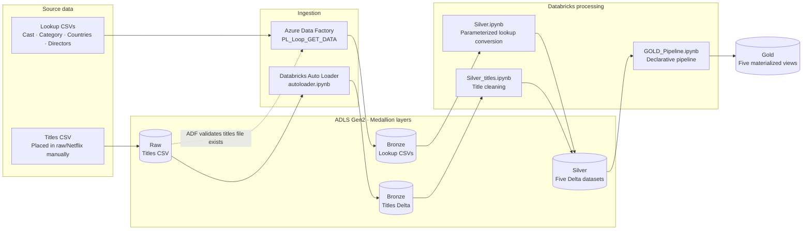

<div align="center">

# Netflix · Azure Data Engineering

**From source CSV files to curated Delta tables and gold materialized views.**

Azure Data Factory · Azure Data Lake Storage Gen2 · Azure Databricks · PySpark

[Architecture](#architecture) · [Quick start](#quick-start) · [Notebooks](#notebook-guide) · [Setup guide](docs/SETUP.md) · [License](#license-and-attribution)

</div>

## Overview

This project implements a layered data engineering workflow for Netflix titles and their cast, categories, countries, and directors. Azure Data Factory ingests lookup CSV files, Databricks Auto Loader ingests title data, PySpark prepares the silver layer, and a declarative gold pipeline publishes materialized views with selected data quality expectations.

The repository contains **ADF source definitions and four Databricks notebooks**. Azure resources, identities, permissions, job definitions, and pipeline settings are configured manually using the [setup guide](docs/SETUP.md). Cloning retrieves the source files; it does not provision or run the cloud environment.

## What this project demonstrates

- Parameterized ingestion of four lookup files through an ADF `ForEach` activity.
- Incremental discovery of title CSV files with Auto Loader and persisted checkpoints.
- Bronze-to-silver conversion of lookup CSVs into Delta format.
- Title cleaning through null filtering, deduplication, trimming, and type conversion.
- Declarative gold materialized views, intermediate views, and row-level expectations.
- Git-based version control for ADF definitions and Databricks notebooks.

## Architecture



**Storage detail:** lookup data remains CSV in bronze; titles are stored as Delta in bronze. Both become Delta in silver. Gold output locations are controlled by the Databricks pipeline's catalog/schema and storage settings, not simply by the existence of a `gold` container.

See [architecture and data lineage](docs/ARCHITECTURE.md) for the gold graph and quality rules.

## Technology stack

| Component | Role |
|---|---|
| Azure Data Factory | HTTP ingestion, file validation, and parameterized copy loop |
| ADLS Gen2 | Raw CSVs, bronze files, silver Delta datasets, and checkpoints |
| Azure Databricks | Notebook execution, Auto Loader, and declarative pipelines |
| PySpark and Spark SQL | DataFrame transformations, schema creation, and validation |
| Delta Lake | Transactional tables for titles bronze and the silver layer |
| Unity Catalog | Catalog/schema organization and governed storage access |
| GitHub | Source control and project documentation |

## Repository structure

```text
.
├── adf/
│   ├── dataset/                 # Parameterized HTTP and ADLS datasets
│   ├── factory/                 # Factory source definition
│   ├── linkedService/           # HTTP and ADLS connections
│   ├── pipeline/                # PL_Loop_GET_DATA
│   └── publish_config.json      # ADF publish branch configuration
├── databricks/
│   ├── autoloader.ipynb         # Raw titles → bronze Delta
│   ├── Silver.ipynb             # Lookup CSVs → silver Delta
│   ├── Silver_titles.ipynb      # Titles Delta → cleaned silver Delta
│   └── GOLD_Pipeline.ipynb      # Silver → gold materialized views
├── docs/
│   ├── ARCHITECTURE.md          # Lineage and design notes
│   └── SETUP.md                 # Manual setup and execution
├── .github/                    # Issue and pull request templates
├── .gitignore
├── CONTRIBUTING.md
├── SECURITY.md
├── NOTICE.md
└── LICENSE
```

## Quick start

### 1. Clone the repository

Repository access is required while this project is private. Authenticate with your own GitHub account; do not embed a token in the clone URL.

```bash
git clone https://github.com/avneetxsingh/netflix-azure-data-engineering.git
cd netflix-azure-data-engineering
```

Alternatively, clone directly in Databricks: create a **Git folder**, select GitHub, and use the same repository URL. Connect your GitHub account when prompted. See the [Databricks Git folder documentation](https://learn.microsoft.com/en-us/azure/databricks/repos/git-operations-with-repos).

### 2. Prepare your environment

You need an Azure subscription, an ADF instance, an ADLS Gen2 account with hierarchical namespace enabled, and a Databricks workspace with appropriate compute, Unity Catalog access, and support for `pyspark.pipelines` in a declarative pipeline.

Create storage containers for `raw`, `bronze`, and `silver`; configure managed catalog storage as required. The original environment also used `gold` and `metastore` containers. Grant the relevant Azure identities and Databricks principals access to their intended paths.

### 3. Configure the source files

Follow [SETUP.md](docs/SETUP.md) to:

1. Replace the original environment's storage account and catalog references.
2. Connect ADF to the repository using `/adf` as its root folder.
3. Reconfigure the imported linked services for your environment.
4. Place `netflix_titles.csv` at `raw/Netflix/netflix_titles.csv` and verify the HTTP lookup source.
5. Confirm the imported notebooks are available in Databricks.

The current ADF HTTP linked service contains a URL ending in `netflix_cast.csv`, while its dataset also supplies a filename. Change the linked-service URL to the **raw directory base URL** before using the multi-file loop. The setup guide includes the exact setting.

### 4. Run in dependency order

| Step | Run | Expected output |
|---|---|---|
| 1 | ADF `PL_Loop_GET_DATA` | Four lookup CSVs under bronze folders |
| 2 | `autoloader.ipynb` | Bronze titles Delta and `raw_titles` catalog table |
| 3 | `Silver.ipynb` for each lookup parameter pair | Four silver Delta datasets |
| 4 | `Silver_titles.ipynb` | Cleaned silver titles Delta |
| 5 | `GOLD_Pipeline.ipynb` through a configured declarative pipeline | Five gold materialized views |

The gold notebook uses pipeline decorators and should run as source for a Databricks declarative pipeline. It is not a standalone local Python program. No job export or deployment bundle is needed to follow the manual process.

## Notebook guide

| Notebook | Input | Main behavior | Output |
|---|---|---|---|
| [autoloader](databricks/autoloader.ipynb) | CSV files under `raw` | Auto Loader discovery, CSV parsing, schema/checkpoint persistence, `availableNow` processing | `netflix_adp.net_schema.raw_titles` and bronze titles Delta |
| [Silver](databricks/Silver.ipynb) | Parameterized bronze lookup CSV | Header/schema inference and Delta conversion | `silver/<folder_name>` |
| [Silver_titles](databricks/Silver_titles.ipynb) | Bronze titles Delta | Remove null IDs; deduplicate by `show_id`; trim `title`; cast `release_year` to integer | `silver/netflix_titles` |
| [GOLD_Pipeline](databricks/GOLD_Pipeline.ipynb) | Five silver Delta datasets | Declarative views, `new_flag` enrichment, and selected quality expectations | Five gold materialized views |

`autoloader.ipynb` contains two streaming writes from the same source: one to a catalog table and one to a bronze Delta path, each with its own stream checkpoint. Silver notebooks overwrite their targets on each run; they do not implement merge-based incremental updates.

## Data model and quality

| Gold object | Purpose | Implemented expectations |
|---|---|---|
| `gold_netflix_titles` | Curated titles with `new_flag = 1` | Non-null `show_id` and `new_flag`; failing rows dropped |
| `gold_netflix_cast` | Title-to-cast associations | Non-null `show_id`; failing rows dropped |
| `gold_netflix_category` | Title-to-category associations | Non-null `show_id`; failing rows dropped |
| `gold_netflix_countries` | Title-to-country associations | Non-null `show_id`; failing rows dropped |
| `gold_netflix_directors` | Title-to-director associations | No explicit expectation in the current source |

These datasets can be related using `show_id`. The source does not declare primary/foreign-key constraints or build a joined reporting mart.

## Validate your run

After completing the setup, confirm:

- ADF copied all four lookup files into their respective bronze folders.
- Bronze titles can be read with `spark.read.format("delta")`.
- All five silver datasets exist and can be read as Delta.
- The gold pipeline completes and reports the expected five materialized views.
- Titles contain unique, non-null `show_id` values and an integer `release_year` field.

Example checks in Databricks SQL; replace the catalog and schema with your pipeline's target:

```sql
SELECT COUNT(*) AS title_count
FROM <catalog>.<gold_schema>.gold_netflix_titles;

SELECT show_id, COUNT(*) AS occurrences
FROM <catalog>.<gold_schema>.gold_netflix_titles
GROUP BY show_id
HAVING COUNT(*) > 1;

SELECT COUNT(*) AS invalid_rows
FROM <catalog>.<gold_schema>.gold_netflix_titles
WHERE show_id IS NULL OR new_flag IS NULL;
```

The last two checks should return no duplicate IDs and zero invalid rows. Counts depend on the source snapshot; notebook outputs are historical examples, not a fixed acceptance baseline.

## Project scope

This is a learning and portfolio implementation with manual environment setup. It includes processing source, rather than a complete deployment package. Cloud resource definitions, permissions, Databricks job/pipeline configuration, schedules, and source datasets are not bundled here.

The original workspace's bronze-to-silver job and gold pipeline were observed completing successfully on November 17, 2026. A clean-environment deployment from this repository has not been verified. See [setup notes and troubleshooting](docs/SETUP.md#troubleshooting) for configuration dependencies in the exported source.

## Contributing

Read [CONTRIBUTING.md](CONTRIBUTING.md) for branch conventions, review expectations, and validation guidance. Use a bug report for reproducible problems and an improvement issue for proposed changes.

For credential or access concerns, follow [SECURITY.md](SECURITY.md). Never include credentials in issues or pull requests.

## License and attribution

Original contributions by Avneet Singh are available under the [MIT License](LICENSE). Third-party data and adapted material retain their own terms; see [NOTICE.md](NOTICE.md) for scope and attribution.

The ingestion configuration references [Ansh Lamba's Netflix Azure Data Engineering Project](https://github.com/anshlambagit/Netflix_Azure_Data_Engineering_Project). This repository is an independent learning project, not an official Netflix product.

**Maintainer:** [Avneet Singh](https://github.com/avneetxsingh)
