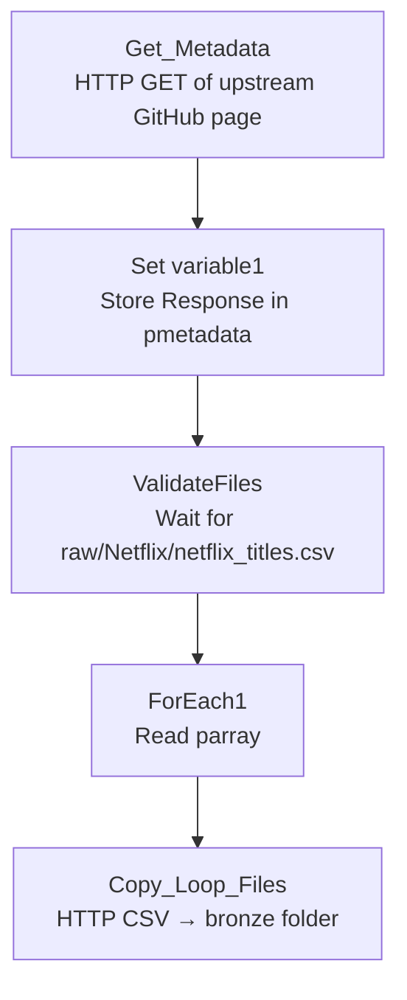
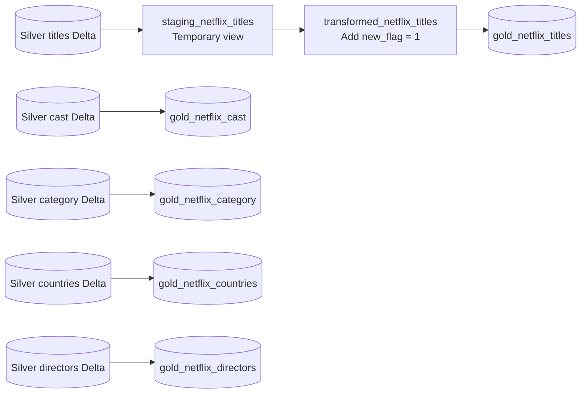

# Architecture and data lineage

[Back to README](../README.md)

## Layer responsibilities

| Layer | Contents | Format | Producer |
|---|---|---|---|
| Raw | Titles source under `Netflix/netflix_titles.csv` | CSV | Manual source placement |
| Bronze lookup | Cast, category, countries, directors folders | CSV | ADF copy loop |
| Bronze titles | `netflix_titles` | Delta | Auto Loader notebook |
| Silver | Five datasets in corresponding folders | Delta | Silver notebooks |
| Gold | Five named materialized views | Pipeline-managed tables | Gold declarative pipeline |

Auto Loader additionally writes `netflix_adp.net_schema.raw_titles`. The catalog table and bronze path are distinct sinks in the current source.

## ADF activity flow

The loop is parameter-driven; it does not discover filenames from `pmetadata`. See the [setup guide](SETUP.md) for the current HTTP base URL and metadata activity considerations.

## Gold lineage

Gold datasets preserve the individual entities. They are not prejoined or aggregated into business metrics.

## Implemented quality behavior

| Stage | Behavior |
|---|---|
| Silver titles | Remove null IDs; deduplicate IDs; trim title; cast release year |
| Silver lookups | Infer CSV schema and write Delta; no explicit cleansing rule |
| Gold titles | Drop rows failing non-null `show_id` or `new_flag` expectations |
| Gold cast/category/countries | Drop rows failing the non-null `show_id` expectation |
| Gold directors | Materialize silver directors without an explicit expectation |

Deduplication does not specify a deterministic winner when multiple different rows share one `show_id`. Type conversion does not itself guarantee every release year is valid; behavior on malformed values can depend on runtime settings.

## Execution and state

- The titles ingestion uses `availableNow` streams, processing available data and then stopping.
- Stream checkpoints track progress; preserve them across normal runs.
- Silver writes use `overwrite` with `overwriteSchema`, replacing target datasets.
- Gold refresh behavior and output placement are configured in the Databricks pipeline.
- No schedule or cross-service orchestration definition is committed. Run stages manually or recreate jobs using the setup guide.

## Design boundaries

The diagrams describe the committed source and its intended manual workflow. Azure provisioning, role assignments, Unity Catalog storage setup, job definitions, monitoring, and deployment automation are outside the committed implementation.

Potential extensions include schema contracts for CSV ingestion, deterministic deduplication, expectations for directors, automated validation, and deployment configuration. These are future improvements, not existing capabilities.
